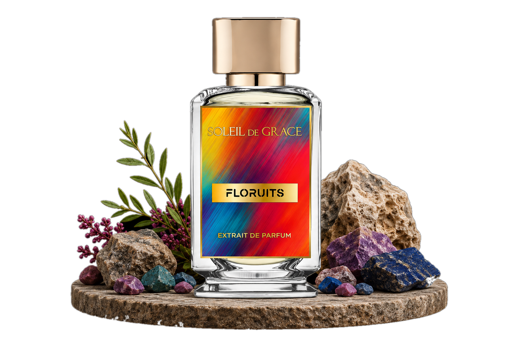

<div align="center">

# Soleil de Grâce

**Ароматы, которые рассказывают истории**

Каталог нишевой парфюмерии · NÉO Collection & The Origins Collection




[Открыть сайт](https://delivery12335.github.io/Soleil-de-Grece/) · [Запуск](#быстрый-старт) · [Структура](#структура-проекта)

</div>

## О проекте

Адаптивная витрина Soleil de Grâce в тёплых кремовых и золотых тонах. В каталоге собраны 14 ароматов двух коллекций: изображения флаконов, главные аккорды, описания и иллюстрированные пирамиды нот.

- Фильтрация каталога по коллекции.
- Отдельная страница каждого аромата: год выпуска, парфюмер, профиль, рейтинг и ноты.
- Переключение русского и английского языка с сохранением выбора в браузере.
- Переход между ароматами стрелками и свайпом на мобильных устройствах.
- Страница о бренде, социальные ссылки и контакты.
- Плавное появление блоков с учётом настройки уменьшения анимации.

Приложение работает на Vue 3 и Vue Router; сборку выполняет Vite. Контент и изображения хранятся в проекте. Серверная часть и база данных для запуска не нужны.

## Быстрый старт

Для локальной работы используйте **Node.js 22 LTS** и npm.

```bash
git clone https://github.com/delivery12335/Soleil-de-Grece.git
cd Soleil-de-Grece
npm ci
npm run dev
```

Откройте адрес, который Vite покажет в терминале — обычно `http://localhost:5173`.

**Windows:** можно запустить `open-site.bat`. Он установит зависимости при первом запуске, запустит сервер и откроет `http://127.0.0.1:5187/`. HTML-файл нужно открывать через сервер Vite.

| Команда | Назначение |
| --- | --- |
| `npm ci` | Установка зависимостей по lock-файлу |
| `npm run dev` | Разработка с автоматическим обновлением |
| `npm run build` | Сборка сайта в `dist/` |
| `npm run build:pages` | Сборка для GitHub Pages с путём репозитория |
| `npm run preview` | Локальный просмотр готовой сборки |

## Структура проекта

```text
public/
└── images/
    ├── perfumes/           # Флаконы и композиции для главных экранов
    ├── notes/              # Изображения парфюмерных нот
    └── social/             # Иконки социальных платформ
src/
├── data/
│   ├── perfumes.js         # Каталог, коллекции, аккорды и контакты
│   └── informationPages.js # Тексты страницы о бренде
├── views/
│   ├── HomeView.vue         # Главная страница и фильтры
│   ├── PerfumeView.vue      # Страница аромата
│   └── InfoPageView.vue     # Страница о бренде
├── App.vue                 # Общая оболочка и навигация
├── i18n.js                 # Переводы и изображения нот
├── main.js                 # Инициализация приложения и маршруты
└── styles.css              # Стили и адаптивная раскладка
index.html                  # Точка входа и метаданные
vite.config.js              # Конфигурация сборки
vercel.json                 # SPA-маршрутизация для Vercel
open-site.bat               # Быстрый запуск на Windows
```

## Редактирование контента

Ароматы, контакты и ссылки редактируются в [`src/data/perfumes.js`](src/data/perfumes.js). Изображения флаконов и главных экранов находятся в `public/images/perfumes/`; пути задаются полями `image` и `heroImage`.

Переводы интерфейса, английские описания и соответствия нот изображениям находятся в [`src/i18n.js`](src/i18n.js). Двуязычные тексты страницы о бренде — в [`src/data/informationPages.js`](src/data/informationPages.js).

| Маршрут | Страница |
| --- | --- |
| `/` | Главная и каталог |
| `/perfume/:slug` | Аромат, например `/perfume/floruits` |
| `/about-us` | О бренде |

## Развёртывание

Сайт опубликован на **GitHub Pages**: [delivery12335.github.io/Soleil-de-Grece](https://delivery12335.github.io/Soleil-de-Grece/).

При каждом push в `main` workflow `.github/workflows/deploy-pages.yml` собирает сайт и публикует его автоматически. В этой сборке изображения учитывают путь репозитория, а страницы используют hash-маршрутизацию: например `/#/perfume/floruits` после адреса репозитория.

Для Vercel импортируйте репозиторий и укажите:

| Настройка | Значение |
| --- | --- |
| Framework Preset | `Vite` |
| Install Command | `npm ci` |
| Build Command | `npm run build` |
| Output Directory | `dist` |

Файл `vercel.json` направляет запросы к страницам приложения в `index.html`, чтобы прямые ссылки на ароматы работали после обновления страницы.

Для других хостингов используйте `npm run build`: эта сборка рассчитана на корень домена. Публикуйте содержимое `dist/` и настройте SPA fallback.

## Источники контента

В данных каталога сохранены ссылки на соответствующие страницы Fragrantica. Описания, ноты и рейтинги хранятся как локальные данные и не обновляются автоматически.

Названия бренда, изображения и материалы принадлежат их правообладателям. Перед публичным размещением проверьте актуальность контактов: в данных присутствует пример email `contact@soleildegrace.example`.
